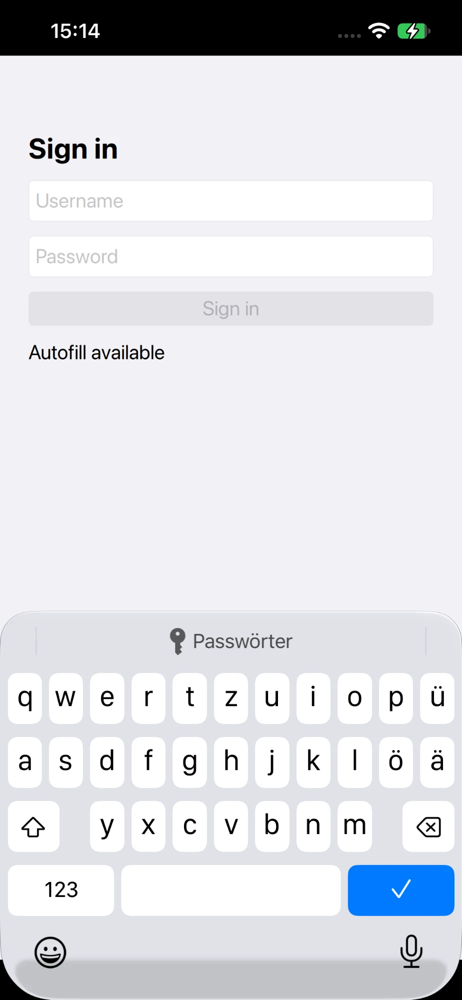
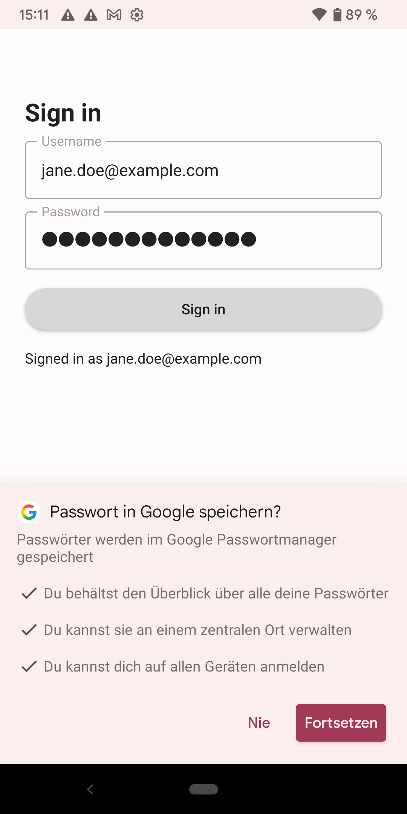

# QtQuickAutofill

Password-manager autofill for Qt Quick text fields on **Android** and **iOS**.

Qt Quick draws its text fields itself, so the platform autofill services (Google Password Manager, 1Password,
Bitwarden, iCloud Keychain, …) do not know that a `TextField` is a username or password field. Qt has no API for it
yet ([QTBUG-114578](https://bugreports.qt.io/browse/QTBUG-114578), [QTBUG-76094](https://bugreports.qt.io/browse/QTBUG-76094)).
This small library fills the gap with one attached property:

```qml
import QtQuickAutofill

TextField {
    placeholderText: "Username"
    Autofill.role: Autofill.Username
}
TextField {
    echoMode: TextInput.Password
    Autofill.role: Autofill.Password
    Autofill.onFilled: (value) => console.log("filled by the password manager")
}
Button {
    text: "Sign in"
    onClicked: {
        // ... after the sign-in succeeded:
        AutofillService.commit()   // lets the platform offer "Save password?"
    }
}
```


&nbsp;


> **Status: experimental (0.1).** It works on the devices listed below, but it relies on platform behaviour and,
> on iOS, on a private Qt class. Please test on your target devices and report what you find.

## What works

| | Android | iOS |
|---|---|---|
| Fields recognised as username/password | Yes, verified (Pixel 3, Android 12, Google autofill) | Yes, verified (iPhone 13, iOS 27) |
| Suggestions appear on focus | Yes, verified (autofill service answers, see *Android notes*) | Yes, verified (QuickType bar shows "Passwords") |
| Picking a suggestion fills the Qt fields | Not verified yet | Not verified yet |
| "Save password?" after sign-in | Yes, verified (`AutofillService.commit()`) | No, needs Associated Domains, see below |
| Desktop | No-op (compiles, does nothing) | |

Roles: `Username`, `Password`, `NewPassword`, `Email`, `OneTimeCode`.

Tested with Qt 6.8 (Android arm64, iOS arm64, macOS). Requires Qt ≥ 6.5 and CMake ≥ 3.21.

## Integration

Add the library to your CMake project (e.g. as a git submodule or with `FetchContent`):

```cmake
add_subdirectory(QtQuickAutofill)

target_link_libraries(myapp PRIVATE QtQuickAutofillplugin)

# Android: merges the library's Java class into your APK (and keeps your own package source dir)
qtquickautofill_configure_android(myapp)                       # or:
qtquickautofill_configure_android(myapp PACKAGE_SOURCE_DIR ${CMAKE_CURRENT_SOURCE_DIR}/android)
```

QtQuickAutofill is a static QML module, so import its plugin once in `main.cpp`:

```cpp
#include <QtQml/qqmlextensionplugin.h>
Q_IMPORT_QML_PLUGIN(QtQuickAutofillPlugin)
```

The fields only need a `text` property and a `textChanged` signal, so `TextInput` and `TextField` both work.

## How it works

### Android

An invisible, non-focusable overlay `View` is added on top of Qt's activity content. It reports every field with
`Autofill.role` to the [autofill framework](https://developer.android.com/identity/autofill) as a *virtual child*
(`onProvideAutofillVirtualStructure`) with hint, input type, bounds and current value. Focus changes, text changes and
`commit()`/`cancel()` are forwarded to `AutofillManager`; values chosen by the user come back through
`View.autofill()` and are written into the QML field. Touch input goes to Qt as before. No Qt internals are touched.

Notes:

- **Gboard and inline suggestions (Android 11+).** On a plain focus change the system waits for an inline-suggestion
  request from the keyboard. Gboard sends it for Qt's own input view, not for the virtual field, so nothing shows up.
  `AutofillService.requestOnFocus` (default `true`) therefore also sends an explicit `requestAutofill()` on focus,
  which the autofill service answers directly. Set it to `false` if your autofill service behaves differently.
- Credentials are saved per app (package name). Several accounts are fine; the user picks one.
- Field bounds are kept up to date while the field has focus (scrolling, keyboard), using `QQuickWindow::afterAnimating`.

### iOS

Qt's input object `QIOSTextInputResponder` implements `UITextInputTraits` but never sets `textContentType`. The library
adds a `textContentType` getter to that class at runtime (Objective-C runtime); it returns the
`UITextContentType` for the `Autofill.role` of the focused item. UIKit then shows password suggestions in the
QuickType bar.

Notes:

- **Private Qt class.** If a future Qt version renames `QIOSTextInputResponder`, the library logs a warning and
  does nothing. Re-test after Qt upgrades.
- **Saving** after sign-in is decided by iOS and requires
  [Associated Domains](https://developer.apple.com/documentation/xcode/supporting-associated-domains)
  (`webcredentials:your.domain`) plus an `apple-app-site-association` file on that domain. `commit()` is a no-op on iOS.
- For the password field, iOS already reacts to `secureTextEntry`, which Qt sets for `echoMode: TextInput.Password`.

## Example and tests

```bash
cmake -S . -B build -DCMAKE_PREFIX_PATH=/path/to/Qt/6.8/macos
cmake --build build
ctest --test-dir build --output-on-failure      # desktop unit tests (QT_QPA_PLATFORM=offscreen)
```

`example/` is a minimal sign-in page. For Android and iOS configure with Qt's `qt-cmake` for that platform.

## Contributing

Reports from other devices, autofill services (1Password, Bitwarden, Samsung Pass, …) and Qt versions are very
welcome, as are pull requests. The most useful open point is confirming that picking a suggestion fills both fields.

## License

[MIT](LICENSE)
